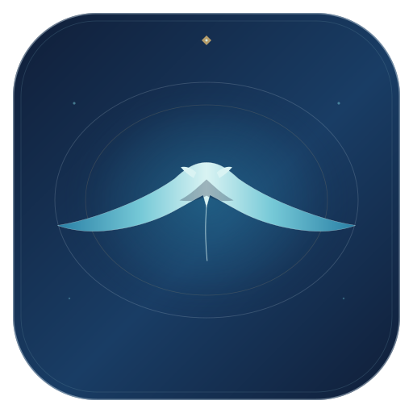
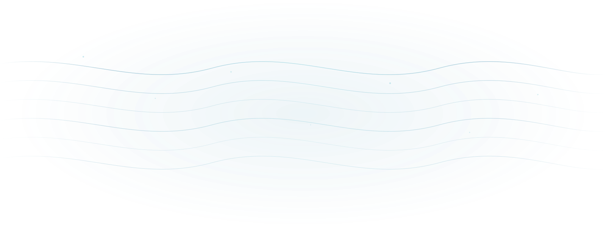
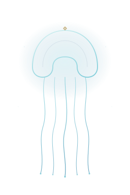
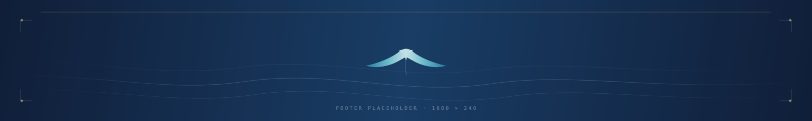

<!--
  Farrel Sheva · GitHub profile README
  Placeholder vector artwork is wired in so the layout can be reviewed.
  Replace files in assets/ in place; keep the same viewBox and aspect ratio.
  Visual system and asset specifications: assets/README.md
-->

  

  

  DEPTH &nbsp;·&nbsp; FLUIDITY &nbsp;·&nbsp; CLARITY

<h1 align="center">Farrel Sheva</h1>

  <strong>Informatics Student · Developer</strong> 
  Building local-first web, mobile, and applied ML tools. 
  <em>Precision beneath the surface.</em>

  <a href="https://github.com/Sheva13?tab=repositories">Repositories</a>
  &nbsp;·&nbsp;
  <a href="#selected-projects">Selected Projects</a>
  &nbsp;·&nbsp;
  <a href="#connect">Connect</a>

  

## About Me

I am an Informatics student and developer who likes software to feel considered at every layer — the interface, the data model, and the system underneath. My public work moves between web platforms, Flutter applications, and applied machine learning. A recurring interest runs through it: local-first tools, clear feedback, and interfaces that make complex state understandable.

I am currently exploring security tooling and computer vision, and I enjoy turning ambiguous problems into small, legible systems.

  

## Technical Interests

- **Applied ML & computer vision** — detection pipelines, evaluation, and human-in-the-loop review.
- **Web platforms & APIs** — type-safe interfaces, FastAPI services, and clear contracts.
- **Mobile & local-first software** — offline data, SQLite, and dependable backup behavior.
- **Security & privacy tooling** — passive analysis, evidence trails, and explainable verdicts.
- **Interface & data visualization** — making complex state readable at a glance.

## Tech Stack

Tools used across these public projects.

| Layer | Tools |
| :--- | :--- |
| **Languages** | TypeScript · Python · Dart · PHP · C++ · SQL |
| **Web** | Next.js · React · Tailwind CSS |
| **Mobile** | Flutter · Riverpod · Drift |
| **Backend** | FastAPI · Laravel · Node.js |
| **Data** | PostgreSQL · SQLite · SQLAlchemy · Alembic |
| **ML / Vision** | Ultralytics YOLO · OpenCV · scikit-learn |
| **Tooling** | Docker Compose · Git · Qt / CMake |

## Selected Projects

### Chess Review
Local-first web app · Next.js · TypeScript · SQLite

A local-first chess analysis workspace powered by Stockfish 19. Import PGN or FEN, classify every move, compare accuracy, and follow the evaluation graph — all locally, with no account or server.

[Repository →](https://github.com/Sheva13/chess_review)

### FinansialKu
Offline Android app · Flutter · Dart · Drift

A personal finance app with budgets, scheduled local backups, and spending insights, built around a reactive Drift/SQLite core.

[Repository →](https://github.com/Sheva13/management-app)

### HelmetWatch
Applied vision prototype · Python · FastAPI · YOLO · PostgreSQL

A computer-vision prototype that flags riders without helmets from camera video, records timestamped evidence, and keeps a human in the review loop.

[Repository →](https://github.com/Sheva13/ai_citra)

### PhishLens
Security project · Next.js · FastAPI · PostgreSQL · scikit-learn

A passive phishing-analysis project for URLs, `.eml` files, and messages — returning a verdict, a 0–100 score, explainable indicators, and recommended actions without opening the target.

[Repository →](https://github.com/Sheva13/UAS-URL-Checker)

Also exploring: <strong>Android Security Auditor</strong> — a native Qt/C++ workspace for Android triage over ADB. <a href="https://github.com/Sheva13/Android-Auditor">Repository →</a>

  

## Connect

The best place to find my work and reach me is GitHub.

- **GitHub** — [@Sheva13](https://github.com/Sheva13)
- **Repositories** — [All public work](https://github.com/Sheva13?tab=repositories)

<!-- Add email, LinkedIn, or a personal site here when available.
     Keep the same two-column bullet rhythm; do not add unverified links. -->

  

  

  Precision beneath the surface. 
  Farrel Sheva · 2026

